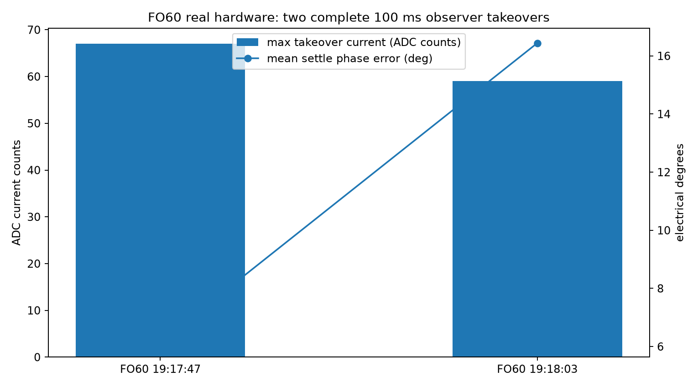
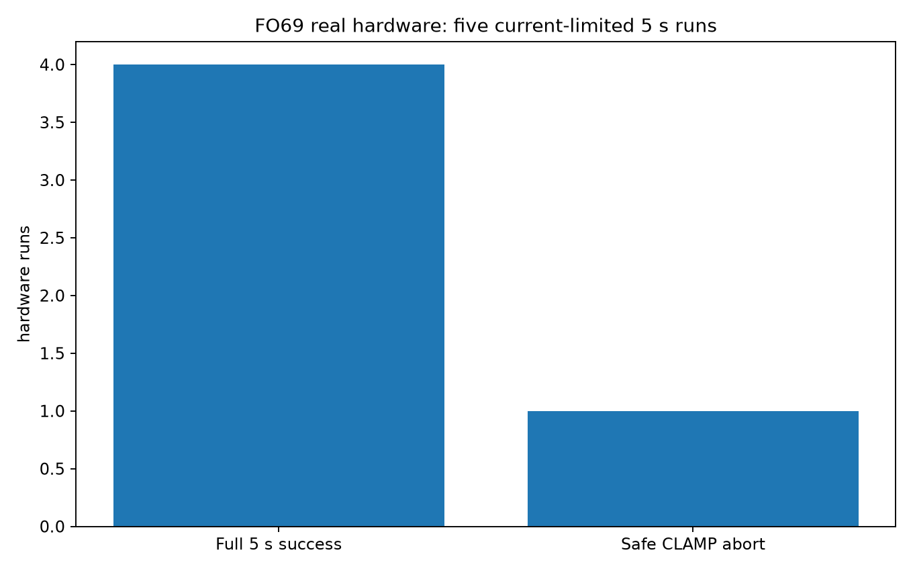
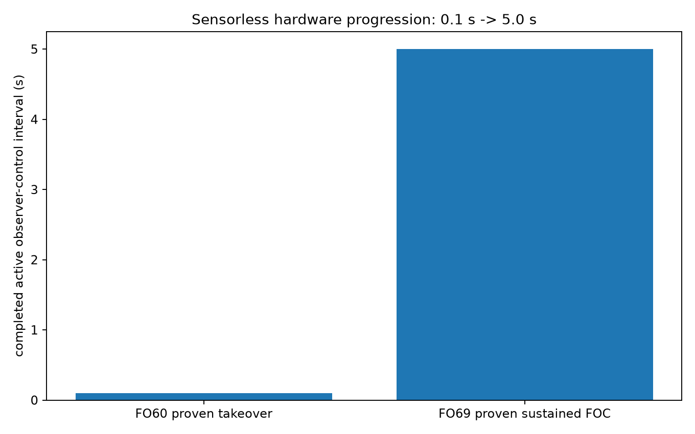

# DeltaESC G30D

> **Current owner instruction (21 October 2026):** Motor development is authorized. Preserve the IAP return path; ST-Link is physically impossible on these controllers. The incoming controller is expected to have DRV 1.8.7; DRV126 is the planned basis and IAP is the flashing method for now. Earlier FO76 hardware flash/motor tests did succeed. See [reread original results and FO91 regression](https://github.com/ZachWay9bot/DeltaESC-G30D/blob/dev/drive-reversible-20261021/docs/HARDWARE_HISTORY_FO76_FO91_20261021.md). The new v0.10.3 candidate has software tests only.

> **SAFETY HOLD (20 October 2026): No new flash approval.** v0.10.2 binaries below are historical experimental artifacts, NOT qualified for sealed UART-only controllers. Older references to accessible ST-Link describe earlier test setups. **ST-Link is physically unavailable on the current target.** Full UART/IAP restore-to-stock and physical flash geometry remain unqualified. Do not use these assets on a potted XBOT. See [recovery qualification](UART_RECOVERY_RELEASE_HOLD.md).

## **Current public version: v0.10.2 ACTIVE TELEMETRY RC**

**FW_BUILD:** `0x1020`  
**Target:** original Ninebot G30D Gen1 3-cap STM32F103 ESC  
**Status:** active experimental bench RC, not a road release

### Downloads

| File | Purpose |
|---|---|
| **[SHU V3 ZIP](downloads/DeltaESC_G30D_v0_10_2_ACTIVE_TELEMETRY_SHU_V3.zip)** | ScooterHacking Utility package |
| **[IAP / App BIN](downloads/DeltaESC_G30D_v0_10_2_active_telemetry_rc.bin)** | raw application image, base `0x08001000` |
| **[Complete Source ZIP](downloads/DeltaESC_G30D_v0_10_2_COMPLETE_SOURCE.zip)** | complete reconstructed v0.10.2 source |
| **[SHA256SUMS](downloads/SHA256SUMS.txt)** | download checksums |

### Sensorless path

```text
DISARMED
  -> neutral confirmed
  -> forward roll >= 3 km/h
  -> passive BEMF qualification
  -> PM-flux phase seed
  -> ROLL_VERIFY at Iq = 0
  -> observer confidence checks
  -> bounded Iq ramp
  -> CLOSED sensorless FOC
```

There is **no ALIGN / OPEN_LOOP fallback** in this release.

### Current profile

- R phase: **0.583 ohm**
- Ld: **0.640 mH**
- PM flux linkage: **12.1 mWb**
- pole pairs: **15**
- forward BEMF rank step: **5**
- rolling-start threshold: **3.0 km/h**
- Flux -> FOC frame offset: **+117.15 electrical degrees**
- first-RC torque cap: **12 current ADC counts**
- hard over-current trip: **96 reconstructed raw counts**

### Telemetry

- **0xFC / RK10:** passive rolling/BEMF evidence
- **0xFD / RC12:** live or latched observer/FOC handover state
- **0xFE / PI12:** current/PWM/ADC and stop/fault context

## Hardware measurement evidence behind the sensorless port

The following plots are from the **XBOT donor hardware validation** that qualified the observer/takeover concepts later integrated into DeltaESC. They are intentionally labeled as donor evidence rather than pretending the current G30D build has already completed those same powered runs.

### FO60: real observer takeover

Two runs completed the full guarded **400/400 control ticks = 100 ms** under flux-angle dq control. A third bad acquisition was rejected before takeover.



### FO69: sustained real FOC

Five current-limited wheel-free 5-second runs: **4 complete successes**, **1 safe CLAMP abort**. Active max current was **24..33 ADC counts**.



### Progression

The proven active observer-control interval progressed from **100 ms in FO60** to **5.0 s in FO69**.



Full measurement notes: **[MEASUREMENTS.md](MEASUREMENTS.md)**

## Flash / build identity

- application base: `0x08001000`
- v0.10.2 BIN size: **32,236 bytes**
- validated build CI: **GitHub Actions run 39159514233**
- BIN SHA-256: `2b6e26b656a25bdab2b2e98eca447452b66628208cecf956e0df01134cf9eb75`

> [!WARNING]
> This build can energize the power stage. The current public version is a **bench release candidate**, not a road-qualified firmware. Further powered candidate tests use the established current-limited, wheel-free setup and the existing IAP return path; ST-Link is unavailable on the current target.

## Public repository layout

The default `main` branch is intentionally kept as the current release landing page. Superseded development material is retained on archive/development branches for traceability but is not presented as current firmware.

## License

GPL-3.0.
